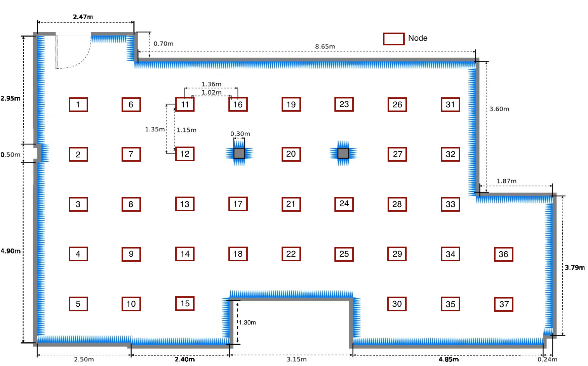

title: R2lab Status
tab: status
skip_header: yes

This page gives you live details on the individual nodes in the R2lab
testbed. You can also [use this link](/iframe.md) in an `<iframe>` tag
from another webpage, or a Jupyter notebook.

---
<h2 id="livemap">Overall status (livemap)</h2>

For accurate dimensions of the room, please see the [static blueprint
at the bottom of this page](#accurate-layout)

For more details about what kind of SDR each node is quipped with, please hover on the node number.

  

  

    

  

<h3 id="livemap:legend">Legend</h3>

##### Nodes
* If only a number appears, this node is turned off.
* A round shape with a O.S. icon informs that the node is turned on, running the
  referenced O.S. and reachable through ssh. On a docker node, the icon is the one of the container, which is what you log into.
* The docker whale  means the node runs docker, and is ready,
  but has no container running yet: there is nothing to log into for now;
  see `rhubarbe docker load -k` to start a container.
* Smaller shapes indicate intermediate / temporary status, and follow the boot sequence
  * a small pale pink dot means the node is turned ON but does not answer to ping yet (BIOS, or the node is being turned on or off)
  * a small green dot, ***pulsing***, means the node answers to ping and its system is starting; ssh is not available yet
  * an orange disc  with two arrows means an image is being ***loaded or saved*** on the node
    (typically by `rload` or `rsave`); the node cannot be used until this completes
  * a small ***red*** dot means the node has been starting for more than 3 minutes: it is probably stuck, and may need to be turned off and on again
* Finally, if a node is hidden behind a large forbidden sign like , it means it
  is out of order, and altogether unavailable.

In addition, you will find the following symbols close to some nodes

*  when the node has a USRP device, that is turned OFF
*  when the node has a USRP device, that is turned ON
*  when the node's USRP device is in unknown state

##### Phone
* Phones in the testbed appear as either
  *  (meaning the phone is in airplane mode)
  *  (meaning it's not in airplane mode)

***

<h2 id="livetable">Detailed status (livetable)</h2>

 

  

    <table class="table table-condensed" id='livetable_container'> </table>
  

<h4 id="livetable:legend">Legend</h4>

The columns, from left to right

* The ***availability*** column
  tells you whether the node is usable or not. If not, this means you should not try to use that node for your experiment, as it may be physically powered off, or otherwise behave erratically.
* The ***on/off*** column
  reports if the node is currently turned on or off.
* The ***ping*** column
  says whether the node currently answers a single ping at the wired network interface or not.
* The ***ssh*** column says whether the node can currently be reached through ssh on its wired interface.
  While an image is being loaded or saved, it shows a  terminal icon instead, as the node
  is then busy with the image loader and not reachable with ssh.
* The ***data interface*** column tells whether the node has a data interface available.
* The ***sdr*** column shows ([see also this page](hardware.md#gory-details))
  * the type of the USRP or other SDR companion (or `none`),
  * together with the attached duplexer if relevant,
  * and the status of the corresponding software switch.
* The ***metal O.S.*** column shows the image name and the O.S. of the node itself (as opposed to a container).
  When the node is not reachable (off, or still starting), it shows what was there ***the last time the node was reachable***;
  this stale information is displayed ***semi-transparent***.
  Hover for details (uname, ssh port, ...), including how long ago the node was last seen.
* The ***docker*** column tells whether the image has docker on board. If so, it shows the image of the container and its O.S. logo
  (the container's, which is what you log into), or `no container` if none is running.
  It is also displayed ***semi-transparent*** when the information is stale, and when the container is stopped.

Also please note that

 * Clicking anywhere in the header will focus on the nodes that are currently up; a second click returns to full mode
   * except in some column headers (like availability or on/off); clicking there will filter on nodes that are available, or turned on, etc..
 * Clicking a node badge will take it off the list
 * Clicking a node in the map will take it back into the list, or off the list if it was present

***

<h3 id="accurate-layout">Accurate layout</h3>

Below is the ground plan layout of the anechoic room which provides thirty-seven wireless nodes distributed in a **≈ 90m2** room.

The nodes are arranged in a grid with ≈1.0m (vertical) and ≈1.15m (horizontal) of distance between them, except for nodes 12, 16, 17, 20 and 23, 24, 27 which are the ones surrounding close to the two columns in the room.

	 
	<!-- 
 Fig. 1 - Resources status
 -->

</a>

***

<h3 id="relays-temperature">Relays temperature status</h3>

please [see the page that displays relay temperatures](/temperatures.md)

***

<h3 id="stats">Usage statistics</h3>

please [see the page that displays usage statistics](/stats.md)

 <!-- container -->
